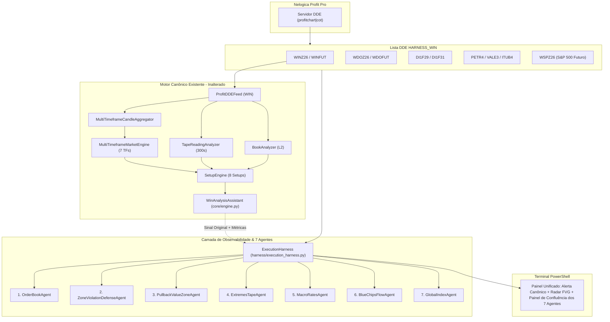

# ARQUITETURA DE AGENTES ESPECIALISTAS & EXECUTION HARNESS — MINI-ÍNDICE WIN (B3)

**Projeto:** `assistente-win-comercial`  
**Ambiente Operacional:** Windows 11 / Python 3.14 / PowerShell 7+  
**Feed de Mercado:** Nelogica Profit Pro via Dynamic Data Exchange (DDE) — `profitchart|cot`  
**Perfil de Execução:** Sub-milissegundo determinístico (Zero Latência de LLM no Caminho Crítico)  

---

## 1. Princípios Fundamentais e Regras Invioláveis

Esta arquitetura introduz uma **camada de observabilidade quântica, telemetria de confluência estatística e apoio à decisão multi-ativo**, concebida sob duas regras fundamentais:

1. **Preservação Absoluta do Legado (Inviolabilidade Algorítmica):**
   - Nenhum arquivo, fórmula matemática, regra de mitigação de 1m, verificação de C.E. (50%), cálculo de deslocamento ou rotina de detecção de COMPRA/VENDA em `core/`, `analysis/`, `feeds/` e `setups/` será removido, substituído ou modificado em sua lógica canônica.
2. **Modo Demo Não-Bloqueante (Zero Guardrails no Sinal Base):**
   - Todos os sinais canônicos emitidos pelo motor original (`SignalSetup`) são repassados integralmente ao terminal. O `ExecutionHarness` opera estritamente como avaliador de probabilidade e confluência contextuais (0% a 100%), permitindo ao operador humano no SuperDOM validar a robustez estatística de cada entrada.



---

## 2. Inventário e Diagnóstico dos Arquivos Existentes

| Módulo Legado | Caminho | Responsabilidade Central | Ponto Notável para o Harness |
| :--- | :--- | :--- | :--- |
| **Feed DDE Win32** | `feeds/dde_feed.py` | Conexão thread-safe com API Win32 (`DdeInitializeW`, `DdeConnect`, `DdeClientTransaction`). Polling de `ULT`, `ABE`, `MAX`, `MIN`, `NEG`, `AGRVOLC`, `AGRVOLV`. | Fornece ticks e candles 1m determinísticos para o ativo monitorado. |
| **Estrutura MTF** | `analysis/market_structure.py` | Avaliação dos 7 tempos (1m, 2m, 5m, 10m, 15m, 30m, 60m), pivôs sem look-ahead bias, BOS, CHoCH, Sweeps e Deslocamento Quantitativo. | Fonte dos pivôs e regimes de mercado intradiários. |
| **Radar FVG MTF** | `analysis/fvg_mtf_scanner.py` | Rastreia FVGs antigos de 5m a 240m, Consequent Encroachment (50% C.E.), aproximação com alerta antecipado e regras de liquidação. | Persistência em `data/active_fvgs_<symbol>.json`. |
| **Tape Reading** | `analysis/tape_reading.py` | Métricas de Times & Trades (300 segundos): delta, razão de delta, grandes lotes (>= 100 contratos) e absorção. | Processa volume e agressão do feed de negócios. |
| **Book L2** | `analysis/book_analyzer.py` | Profundidade Top 5/Top 10, Imbalance, dispersão de ofertas e identificação descritiva de blefe/pulling passivo. | Gera métricas de liquidez estática. |
| **Setups SMC** | `setups/setup_engine.py` | Avalia 8 setups canônicos + módulo de abertura (1ª barra 5m/2m), caixotes e defesas institucionais. | Gera instâncias de `SignalSetup` com Stop e Alvo. |
| **Formatador PowerShell** | `analysis/alert_formatter.py` | Monta o layout ANSI com Seção 1 (Geral), Seção 2 (SuperDOM), Seção 3 (`BOOK:` e `TIMES & TRADES:`), e Rodapé SuperDOM. | Ponto de injeção visual para telemetria dos Agentes. |
| **Orquestrador Central** | `core/engine.py` | `WinAnalysisAssistant`: consome feed, dispara setups, executa `format_operational_alert`, gera áudio (5 apitos) e grava arquivos de log. | Ponto de integração do Harness. |

---

## 3. Matriz de Conexão DDE: Lista `HARNESS_WIN`

O `ExecutionHarness` mantém conexões simultâneas com a grade oficial de tickers do Profit Pro no serviço `profitchart` e tópico `cot`:

| Ticker B3 | Tipo de Ativo | Variáveis DDE Coletadas | Finalidade Estrutural no Harness |
| :--- | :--- | :--- | :--- |
| **`WINZ26` / `WINFUT`** | Mini-Índice Futuro | `ULT`, `ABE`, `MAX`, `MIN`, `NEG`, `AGRVOLC`, `AGRVOLV` | Ativo-alvo operacional, Tape Reading e Book L2. |
| **`WDOZ26` / `WDOFUT`** | Mini-Dólar Futuro | `ULT`, `ABE`, `MAX`, `MIN`, `AGRVOLC`, `AGRVOLV` | Correlação cambial inversa e pressão de fluxo cambial. |
| **`DI1F29`** | Juro Futuro B3 (Miolo) | `ULT`, `ABE`, `MAX`, `MIN`, `VAR` | Vértice médio da curva de juros (curva de inclinação). |
| **`DI1F31`** | Juro Futuro B3 (Longo) | `ULT`, `ABE`, `MAX`, `MIN`, `VAR` | Vértice longo da curva de juros (aversão a risco soberano). |
| **`PETR4`** | Ação Petrobras PN | `ULT`, `ABE`, `MAX`, `MIN`, `AGRVOLC`, `AGRVOLV` | Peso pesado (Commodity fóssil / risco estatal). |
| **`VALE3`** | Ação Vale ON | `ULT`, `ABE`, `MAX`, `MIN`, `AGRVOLC`, `AGRVOLV` | Maior peso individual do IBOV (Commodity metálica). |
| **`ITUB4`** | Ação Itaú Unibanco PN | `ULT`, `ABE`, `MAX`, `MIN`, `AGRVOLC`, `AGRVOLV` | Termômetro do setor bancário e fluxo financeiro local. |
| **`WSPZ26`** | Mini S&P 500 Futuro B3 | `ULT`, `ABE`, `MAX`, `MIN`, `VAR` | Apetite global a risco (Risk-On / Risk-Off internacional). |

---

## 4. Arquitetura dos 7 Agentes Especialistas

Cada agente herda de uma interface base determinística (`BaseSpecialistAgent`), processa ticks em memória sem alocação dinâmica desnecessária e emite um parecer padronizado (`AgentOpinion`).

```python
@dataclass
class AgentOpinion:
    agent_name: str
    weight: float              # Peso relativo na decisão final (0.0 a 1.0)
    score: float               # -1.0 (Venda Máxima) a +1.0 (Compra Máxima)
    confidence: float          # Convicção dos dados (0.0 a 1.0)
    primary_metric: str        # Resumo textual da métrica chave
    details: Dict[str, Any]    # Dicionário estruturado para logs e telemetria
    recommendation: str        # 'ALINHADO_COMPRA', 'ALINHADO_VENDA', 'NEUTRO', 'DIVERGENTE'
```

### 4.1. `OrderBookAgent` (`agents/order_book_agent.py`)
- **Responsabilidade:** Análise de microestrutura do Book L2 (Top 5 e Top 10 níveis), desbalanceamento de liquidez passiva (Imbalance), dispersão de ofertas e monitoramento de pulling/blefe.
- **Inputs DDE:** Book L2 de `WINZ26` / `WINFUT` (e `WDOZ26`).
- **Lógica e Thresholds:**
  - Imbalance Top 5: $\frac{\text{BidVol} - \text{AskVol}}{\text{BidVol} + \text{AskVol}}$. Valores $> +0.40$ indicam pressão compradora passiva; $< -0.40$ vendedora.
  - Alerta de Blefe Passivo: Ofertas $\ge 200$ contratos que permanecem $< 10$ segundos no book e desaparecem a menos de 25 pontos do preço corrente.
  - Convicção decresce caso o feed de profundidade não possua granularidade de ordens individuais.

### 4.2. `ZoneViolationDefenseAgent` (`agents/zone_defense_agent.py`)
- **Responsabilidade:** Monitoramento contínuo de zonas Fair Value Gap (FVG MTF: 240m, 60m, 30m, 15m, 10m, 5m), inversão de FVGs (iFVG), Order Blocks e Consequent Encroachment (50% C.E.).
- **Inputs DDE:** Cotação e extremos de `WINZ26` / `WINFUT` + `analysis/fvg_mtf_scanner.py`.
- **Lógica e Thresholds:**
  - Máquina de Estados: `UNMITIGATED` $\to$ `TESTING_CONTINUATION` $\to$ `INVERTED_PENDING_RETEST` $\to$ `LIQUIDATED`.
  - Rejeição defensiva: Preço penetra até o nível de 50% C.E., sem fechar candle além da borda externa do FVG, gerando rejeição por pavio.
  - Alerta de Violacão de Alvo: Se houver zona institucional contrária a $< 200$ pts do preço na direção do trade, aponta probabilidade de barreira técnica.

### 4.3. `PullbackValueZoneAgent` (`agents/value_zone_agent.py`)
- **Responsabilidade:** Localização dentro do Dealing Range institucional (Topos e Fundos macro de 60m/15m) e mapeamento de Caixotes Intradiários.
- **Inputs DDE:** Cotações de `WINZ26` / `WINFUT` + pivôs de `analysis/market_structure.py`.
- **Lógica e Thresholds:**
  - Equilíbrio (50% Equilibrium):
    $$\text{Equilibrium} = \frac{\text{DealingRange}_{\text{High}} + \text{DealingRange}_{\text{Low}}}{2}$$
  - **Regra de Valor:** Preço acima de 50% = *Zona Premium* (propensão exclusiva para vendas); Preço abaixo de 50% = *Zona Discount* (propensão exclusiva para compras).
  - **Filtro de Miolo (Caixote):** Posição entre 15% e 85% do range intradiário é classificada como *Região Central / Baixa Assimetria*, pontuando neutro ou divergente para rompimentos secos.

### 4.4. `ExtremesTapeAgent` (`agents/extremes_tape_agent.py`)
- **Responsabilidade:** Agressão e fluxo de ordens no Times & Trades (janela deslizante de 300 segundos).
- **Inputs DDE:** `WIN.ULT`, `WIN.AGRVOLC`, `WIN.AGRVOLV` e negócios tick-a-tick.
- **Lógica e Thresholds:**
  - Delta Direcional: $\Delta = \text{AGRVOLC} - \text{AGRVOLV}$.
  - Detecção de Absorção Institucional:
    - Compradora: $\Delta < -500$ contratos enquanto o preço recua menos de 15 pontos em suporte.
    - Vendedora: $\Delta > +500$ contratos enquanto o preço sobe menos de 15 pontos em resistência.
  - Grandes Agressões: Rastreamento de trades individuais com $\ge 100$ contratos.

### 4.5. `MacroRatesAgent` (`agents/macro_rates_agent.py`)
- **Responsabilidade:** Monitoramento da curva de juros futuros de Depósito Interfinanceiro (DI1) e do diferencial de prêmio de risco.
- **Inputs DDE:** `DI1F29.ULT`, `DI1F31.ULT` (cotações e taxas de fechamento anterior).
- **Lógica e Thresholds:**
  - Variação do DI1: $\Delta\text{DI} = \text{TaxaAtual} - \text{TaxaAbertura}$.
  - Correlação Histórica B3: Abertura forte da curva de DI ($\Delta\text{DI} > +0.05\%$ em F29/F31) gera pressão desfavorável a ativos de risco e índice futuro, reduzindo probabilidade de compras no WIN. Fechamento de curva ($\Delta\text{DI} < -0.05\%$) favorece momentum comprador.

### 4.6. `BlueChipsFlowAgent` (`agents/blue_chips_agent.py`)
- **Responsabilidade:** Força e alinhamento do fluxo das 3 principais ações do Ibovespa (`PETR4`, `VALE3`, `ITUB4`), que representam o núcleo ponderado do índice à vista.
- **Inputs DDE:** `PETR4` (ULT, ABE, AGRVOLC/V), `VALE3` (ULT, ABE, AGRVOLC/V), `ITUB4` (ULT, ABE).
- **Lógica e Thresholds:**
  - Retorno Ponderado da Cesta ($R_{\text{Basket}}$):
    $$R_{\text{Basket}} = 0.40 \cdot \Delta\%_{\text{VALE3}} + 0.35 \cdot \Delta\%_{\text{PETR4}} + 0.25 \cdot \Delta\%_{\text{ITUB4}}$$
  - Se $R_{\text{Basket}} > +0.50\%$ com Delta comprador nas 3 líderes, compras no WIN recebem confluência máxima; se $R_{\text{Basket}} < -0.50\%$, vendas recebem confluência máxima. Divergências setoriais (ex: VALE3 subindo e PETR4/ITUB4 despencando) acendem alerta de rotação de carteira.

### 4.7. `GlobalIndexAgent` (`agents/global_index_agent.py`)
- **Responsabilidade:** Alinhamento com os mercados internacionais de ações e correlação cambial.
- **Inputs DDE:** `WSPZ26` (Mini S&P 500 Futuro na B3) e `WDOZ26` / `WDOFUT` (Mini-Dólar).
- **Lógica e Thresholds:**
  - Regime Global: S&P em alta intraday ($> +0.30\%$) e Dólar em queda ($< -0.30\%$) configuram cenário canônico de *Global Risk-On* (alta probabilidade para compras no WIN).
  - S&P em queda com disparada do Dólar configura *Global Risk-Off* (alta probabilidade para vendas no WIN). Descolamentos locais são pontuados com menor convicção macro.

---

## 5. Arquitetura do `ExecutionHarness`

O `ExecutionHarness` (`harness/execution_harness.py`) é o motor orquestrador em tempo real:

1. **Gestão das Threads de Polling DDE:**
   - Mantém uma instância DDE multi-tópico para a grade `HARNESS_WIN` ou reaproveita o feed principal do WIN para o algoritmo canônico, agregando o polling dos ativos periféricos sem onerar a thread principal do Windows.
2. **Ciclo de Avaliação dos Agentes:**
   - A cada atualização do mercado (ou ciclo de 1 a 2 segundos do dashboard), o Harness despacha os dados mais recentes para os 7 agentes, coleta seus `AgentOpinion` e computa o **Score Global de Confluência**:
     $$\text{ConfluenceScore} = \sum_{i=1}^{7} w_i \cdot \text{Score}_i \cdot \text{Confidence}_i$$
     $$\text{ConfidencePercentage} = \frac{1 + \text{ConfluenceScore}}{2} \times 100\%$$
3. **Composição Visual Não-Destrutiva:**
   - O Harness concatena ao texto emitido por `format_operational_alert` um sub-bloco de telemetria altamente legível no PowerShell:

```text
==================================================================
EXECUTION HARNESS — PAINEL DE CONFLUÊNCIA QUANTITATIVA (7 AGENTES)
STATUS OPERACIONAL: MODO DEMO ATIVO (SINAIS ORIGINAIS 100% LIBERADOS)
CONFIANÇA MATEMÁTICA CONSOLIDADA: 78.4% [ALTA CONFLUÊNCIA COMPRADORA]
------------------------------------------------------------------
AGENTE                         SCORE   PESO  CONV.  PARECER E MÉTRICA CHAVE
1. OrderBookAgent             +0.80   0.15   0.90   Imbalance Top5: +52% | Sem blefe
2. ZoneViolationDefenseAgent  +0.70   0.20   0.85   Defesa FVG 15m (CE 50% preservado)
3. PullbackValueZoneAgent     +0.90   0.15   0.95   Zona Discount (34% do DR 60m)
4. ExtremesTapeAgent          +0.85   0.20   0.90   Delta +1.240ct | Absorção vendedora
5. MacroRatesAgent            +0.60   0.10   0.80   DI1F29 -0.06% (Curva fechando)
6. BlueChipsFlowAgent         +0.75   0.10   0.85   VALE3 +1.2% / PETR4 +0.8%
7. GlobalIndexAgent           +0.65   0.10   0.80   WSP +0.45% / WDO -0.38% (Risk-On)
------------------------------------------------------------------
DIAGNÓSTICO HARNESS: Sinal canônico alinhado com 7 de 7 agentes especialistas.
==================================================================
```

---

## 6. Ponto Exato de Integração Não-Destrutiva

Para garantir conformidade estrita com as **Regras Invioláveis 1 e 2**, a integração física no código seguirá o padrão **Decorator / Pipeline Wrapper**:

1. **Local de Chamada no Loop Principal (`ui/dashboard.py` / `main.py`):**
   - O `WinAnalysisAssistant` em `core/engine.py` permanece completamente intacto.
   - Em `ui/dashboard.py` (ou em um ponto de entrada estendido `main_harness.py`), após a execução de:
     ```python
     alert_text = assistant.evaluate_now()
     ```
   - O `ExecutionHarness` intercepta `alert_text` e o estado atual do `assistant`:
     ```python
     harness_banner = harness.evaluate_market_confluence(assistant)
     full_dashboard_text = alert_text + "\n" + harness_banner
     print("\n" + full_dashboard_text + "\n")
     ```
2. **Nenhuma alteração nos arquivos originais:**
   - Arquivos legados mantêm seus checksums originais.
   - Toda nova funcionalidade reside estritamente em `agents/` e `harness/`.
   - Testes unitários novos residem em `tests/test_harness_agents.py` sem interferir em `tests/test_units.py` ou `tests/test_backtest.py`.

---

## 7. Próximos Passos (Etapas Seguintes)

1. Implementação das classes dos 7 Agentes Especialistas em `agents/`.
2. Implementação do `ExecutionHarness` e do conector DDE multi-ativo em `harness/`.
3. Testes unitários determinísticos em `tests/test_harness_agents.py` cobrindo cenários de alta/baixa confluência e descolamento macro.
4. Homologação do pipeline de visualização no PowerShell.
